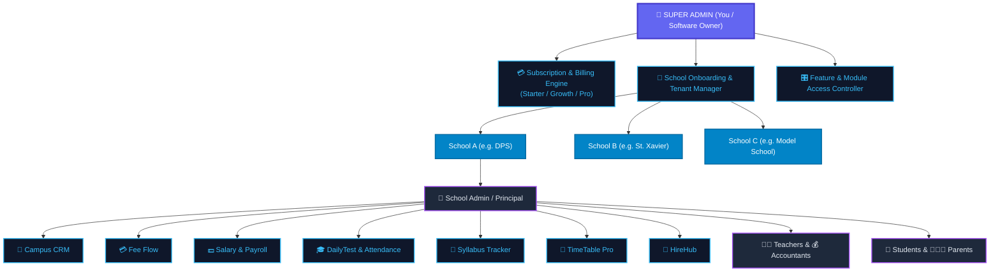
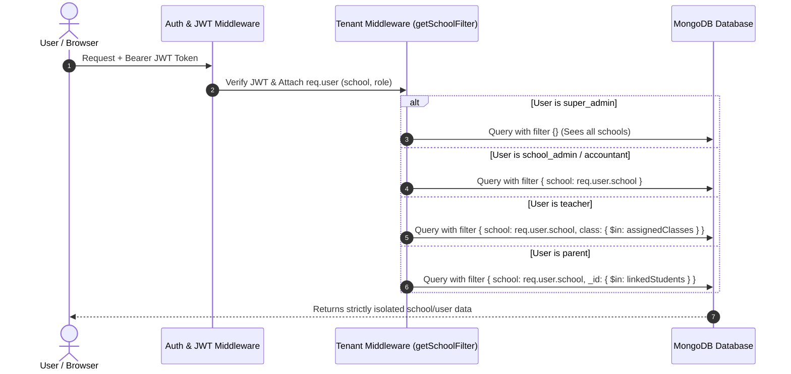
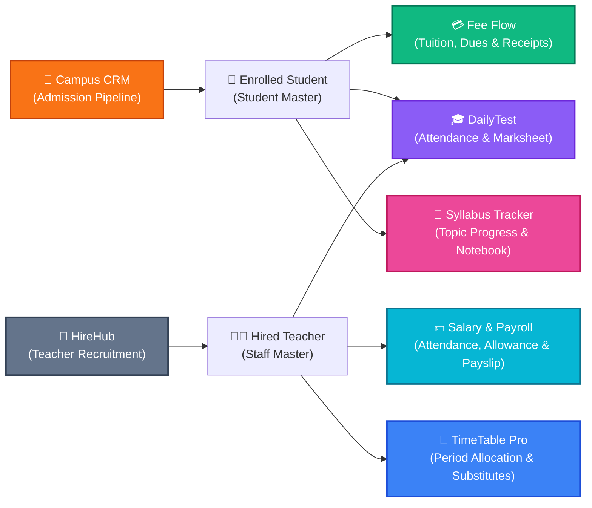

# 🌟 UNIFIED SCHOOL ERP (SaaS Platform) - ARCHITECTURE & FLOW DOCUMENTATION

---

## 📌 Executive Overview
**School ERP** is an enterprise-grade, multi-tenant SaaS platform integrating:
* 🎓 **DailyTest** (Attendance, Daily Tests, Marksheet Generation & Performance Analytics)
* 📅 **TimeTable Pro** (Period Scheduling, Teacher Conflict Prevention, Substitutes)
* 💼 **HireHub** (Staff Recruitment, Vacancies, Interview Pipeline)
* 📖 **Syllabus Tracker** (Chapter & Topic Progression, Notebook Checks)
* 🎯 **Campus CRM** (Admissions Pipeline, Inquiries, Follow-up Logs)
* 💳 **Fee Flow** (Fee Structure, Counter Collection, Invoices, Dues & Defaulters)
* 💵 **Salary & Payroll** (Staff Biometric Attendance, Salary Rules, Payslips, Advances)
* 📱 **Student & Parent Portals** (Real-time updates, Leave Requests, Online Fee Payments)

---

## 🌌 Platform Hierarchy Flow (SaaS Level vs Tenant Level)

---

## 👥 Multi-Role & Permissions Matrix (RBAC)

| Role Code | Role Title | Tenant Filter Scope | Core Permissions & Capabilities |
| :--- | :--- | :--- | :--- |
| `super_admin` | **Platform Master** | `{}` *(Global - All Schools)* | Onboard schools, define subscription plans, handle billing cutoffs, toggle modules, impersonate school admin for support. |
| `school_admin`| **Principal / Director** | `{ school: user.school }` | Manage school academic sessions, classes, sections, staff accounts, approve admissions, school-wide reports. |
| `accountant` | **Fee & Cash Clerk** | `{ school: user.school }` | Fee collection counter, print payment slips, manage dues list, record school expenses, fee discount approvals. |
| `teacher` | **Faculty Member** | `{ school: user.school, assignedClasses: [...] }` | Mark daily class attendance, assign homework, upload study notes, enter exam & test marks, report remarks. |
| `student` | **Enrolled Student** | `{ school: user.school, _id: studentId }` | View personal attendance, class timetable, homework, download fee slips, view exam report cards. |
| `parent` | **Guardian** | `{ school: user.school, _id: { $in: linkedStudents } }` | Switch between children, real-time attendance alerts, pay fee online, inspect test performance, apply leave. |

---

## 🔒 Multi-Tenant Data Isolation Architecture (TestMaster Pattern)

---

## 🧩 Unified Modules Integration Breakdown

---

## 🗺️ Step-by-Step Modular Roadmap

1. **Step 1: Foundation Setup (Architecture Base)**
   * Frontend: React + Vite + Tailwind CSS + Lucide Icons + TanStack Table
   * Backend: Node.js (Express) + PostgreSQL + Prisma ORM + JWT Auth
   * Multi-Tenant Middleware (`tenant.js`) & Role-Based Access Control (`checkRole`)
   * Core Schema: `School`, `User`, `AcademicSession`, `Class`, `Section`, `Subject`

2. **Step 2: Super Admin Platform Engine**
   * School Onboarding & Approval workflow
   * Subscription Plans & Pricing engine (Student limits, expiry dates)
   * Feature & Module flags (Enable/disable CRM, Fee, Salary, etc. per school)
   * Login as School Admin (Impersonation for customer support)

3. **Step 3: Campus CRM Module**
   * Enquiry registration form & lead categorization (Hot / Warm / Cold)
   * Follow-up call logs and status tracking
   * 1-Click admission conversion into student master

4. **Step 4: Fee Flow Module**
   * Class-wise fee structure templates (Tuition, Transport, Exam, Term)
   * Fast Counter Collection with auto-generated receipt numbering
   * Dues & Defaulter tracking with printable reminders & WhatsApp/SMS alerts
   * Daily cash collection register & daybook

5. **Step 5: Salary & Payroll Module**
   * Staff salary components (Basic, HRA, Allowance, PF, ESI, Deductions)
   * Attendance-linked working days & unpaid leaves calculation
   * Advance salary & loan installment deductions
   * 1-Click monthly payroll generation & printable Payslips

6. **Step 6: DailyTest & Academic Performance**
   * Quick bulk student attendance marking (Web & Mobile optimized)
   * Daily test scheduling & subject mark entries
   * Automated grading, ranks, and customizable term marksheet generation

7. **Step 7: Syllabus Tracker Module**
   * Class & subject-wise chapter breakdown with sub-topics
   * Completed vs Pending topic progress percentages
   * Daily lesson plan logs & student notebook checking records

8. **Step 8: TimeTable Pro Module**
   * Dynamic class period schedule matrix
   * Teacher timetable & clash prevention algorithm
   * Absentee teacher substitution auto-recommender

9. **Step 9: HireHub Module**
   * School vacancy postings (Subject Teacher, Accountant, Peon, etc.)
   * Applicant screening pipeline (Applied -> Interview -> Offer -> Hired)
   * Direct 1-click staff onboarding into Staff Master

10. **Step 10: Student & Parent Mobile Portal**
    * Multi-child switching for parents
    * Real-time attendance, test score alerts, fee payments & leave applications
